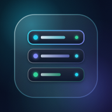

[English](README.md) | [Français](README.fr.md)

<div align="center">
  
  <h1>PVE Command Center — Site Vitrine & Documentation</h1>
  <p>
    <strong>Portail officiel VitePress, hub de téléchargement multi-plateformes et documentation technique bilingue (FR / EN) de l’écosystème PVE Command Center.</strong>
  </p>
  <p>
    <a href="https://pve-center.github.io/pve-center-website/fr/"></a>
    
    <a href="LICENSE"></a>
  </p>
</div>

---

## ✨ Contenu de ce dépôt

- **Pages d’accueil (`docs/index.md`, `docs/fr/index.md`)** : vitrine Liquid Glass & Cider Studio incluant l’aperçu interactif des 6 thèmes d’accentuation, le catalogue des 28 icônes Homelab, les captures réelles iOS & Apple TV et le **Hub de téléchargement** (macOS, iOS/iPadOS, Apple TV `tvOS`, Windows, Linux, Android et Proxmox LXC/Docker).
- **Documentation technique bilingue complète (`/` en anglais et `/fr/` en français)** :
  - Démarrage rapide & présentation des 4 dépôts (`guide/getting-started.md`)
  - Installation & Déploiement (`install.sh`, Docker Compose `host`/`bridge`, Tailscale Serve SSO, Bonjour mDNS) (`guide/installation.md`)
  - Architecture & Sécurité (FastAPI, SQLite WAL, DualAuth ASGI, AlertEngine, WebSocket/SSE, appairage Apple TV P-256 ECDH) (`guide/architecture.md`)
  - Guides Clients Multi-Plateformes (Apple Swift 6, Desktop Tauri v2, Android Capacitor 8) (`guide/clients.md`)
  - Configuration `config.yaml`, sondes & canaux de notifications (`reference/configuration.md`)
  - Référence API REST, WebSocket & SSE (`reference/api.md`)
- **Déploiement continu GitHub Pages** : compilation automatique sur Node.js 22 via [`.github/workflows/deploy-pages.yml`](.github/workflows/deploy-pages.yml).

---

## 🚀 Développement local & Compilation

```bash
git clone https://github.com/PVE-Center/pve-center-website.git
cd pve-center-website
npm ci

# Serveur de développement VitePress avec rechargement à chaud
npm run docs:dev

# Compilation statique (vérifie l'absence de liens morts)
npm run docs:build

# Prévisualisation locale du build
npm run docs:preview
```

---

## 🌐 Écosystème PVE-Center

| Dépôt | Description | Lien |
|---|---|---|
| **Serveur & UI Web** | Backend FastAPI, SQLite WAL, AlertEngine, mDNS, PWA React 19, Docker & `install.sh` | [PVE-Center/pve-panel](https://github.com/PVE-Center/pve-panel) |
| **Apple Natif** | Application unifiée Swift 6 / SwiftUI pour iPhone, iPad, Mac & Apple TV (`tvOS 27.0`) | [PVE-Center/pve-center-apple](https://github.com/PVE-Center/pve-center-apple) |
| **Desktop & Android** | Clients Tauri v2 (Windows `.msi`/`.exe`, Linux `.AppImage`/`.deb`) & APK Android Capacitor 8 | [PVE-Center/pve-center-clients](https://github.com/PVE-Center/pve-center-clients) |
| **Site & Documentation** | Vitrine VitePress bilingue et portail documentaire (ce dépôt) | [PVE-Center/pve-center-website](https://github.com/PVE-Center/pve-center-website) |

---

## 🤝 Contribution & Licence

Les améliorations documentaires et traductions sont les bienvenues ! Consultez [CONTRIBUTING.md](CONTRIBUTING.md) et le [Code de conduite](CODE_OF_CONDUCT.md).

Distribué sous [licence MIT](LICENSE).
