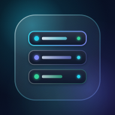

[English](README.md) | [Français](README.fr.md)

<div align="center">
  
  <h1>PVE Command Center — Website & Documentation Portal</h1>
  <p>
    <strong>Official VitePress showcase, multi-platform download hub, and bilingual (EN / FR) technical documentation for the PVE Command Center ecosystem.</strong>
  </p>
  <p>
    <a href="https://fairy-jeux.github.io/pve-center-website/"></a>
    
    <a href="LICENSE"></a>
  </p>
</div>

---

## ✨ What This Repository Provides

- **Landing Pages (`docs/index.md`, `docs/fr/index.md`)**: Liquid Glass & Cider Studio showcase featuring interactive accent theme previews (6 themes), the 28-brand Homelab Icon Catalog, real Apple & tvOS screenshots, and a **Per-Platform Download Hub** for macOS, iOS/iPadOS, Apple TV (`tvOS`), Windows, Linux, Android, and Proxmox LXC/Docker.
- **Complete Bilingual Documentation (`EN` at `/` and `FR` at `/fr/`)**:
  - Getting Started & 4-Repo Ecosystem Overview (`guide/getting-started.md`)
  - Installation & Deployment (`install.sh`, Docker Compose `host`/`bridge`, Tailscale Serve SSO, Bonjour mDNS) (`guide/installation.md`)
  - Architecture & Security (FastAPI, SQLite WAL, DualAuth ASGI, AlertEngine, WebSocket/SSE, Apple TV P-256 ECDH pairing) (`guide/architecture.md`)
  - Multi-Platform Client Guides (Apple Swift 6, Tauri v2 Desktop, Capacitor 8 Android) (`guide/clients.md`)
  - Configuration, Connectors & Notification Channels (`reference/configuration.md`)
  - REST, WebSocket & SSE API Reference (`reference/api.md`)
- **Automated GitHub Pages Deployment**: Built and deployed on push to `main` via [`.github/workflows/deploy-pages.yml`](.github/workflows/deploy-pages.yml) on Node.js 22.

---

## 🚀 Local Development & Build

```bash
git clone https://github.com/Fairy-Jeux/pve-center-website.git
cd pve-center-website
npm ci

# Start local VitePress dev server with hot-reload
npm run docs:dev

# Build production static site (verified for dead links)
npm run docs:build

# Preview built site locally
npm run docs:preview
```

---

## 🌐 Fairy-Jeux PVE Command Center Ecosystem

| Repository | Description | Link |
|---|---|---|
| **Server & Web UI** | FastAPI backend, SQLite WAL, AlertEngine, mDNS, React 19 PWA, Docker & `install.sh` | [Fairy-Jeux/pve-panel](https://github.com/Fairy-Jeux/pve-panel) |
| **Apple Native** | Unified Swift 6 / SwiftUI app for iPhone, iPad, Mac & Apple TV (`tvOS 27.0`) | [Fairy-Jeux/pve-center-apple](https://github.com/Fairy-Jeux/pve-center-apple) |
| **Desktop & Android** | Tauri v2 desktop clients (Windows `.msi`/`.exe`, Linux `.AppImage`/`.deb`) & Capacitor 8 Android `.apk` | [Fairy-Jeux/pve-center-clients](https://github.com/Fairy-Jeux/pve-center-clients) |
| **Website & Docs** | Bilingual VitePress showcase & documentation portal (this repository) | [Fairy-Jeux/pve-center-website](https://github.com/Fairy-Jeux/pve-center-website) |

---

## 🤝 Contributing & License

Contributions to documentation, translations, and portal UX are welcome! See [CONTRIBUTING.md](CONTRIBUTING.md) and our [Code of Conduct](CODE_OF_CONDUCT.md).

Distributed under the [MIT License](LICENSE).
